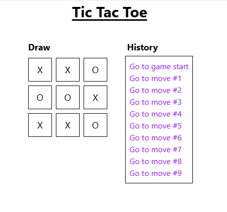

# Tic-Tac-Toe

A Tic-Tac-Toe game built while following the official [React Tutorial: Tic-Tac-Toe](https://react.dev/learn/tutorial-tic-tac-toe) from react.dev. This project is used to practice core React concepts like components, props, state, and lifting state up.

Built with React and Vite, styled with Tailwind CSS.



## Getting Started

Install dependencies:

```bash
npm install
```

Run the dev server:

```bash
npm run dev
```

## Scripts

- `npm run dev` — start the development server
- `npm run build` — build for production
- `npm run preview` — preview the production build
- `npm run lint` — run ESLint

## Reference

- [React Tutorial: Tic-Tac-Toe](https://react.dev/learn/tutorial-tic-tac-toe)
